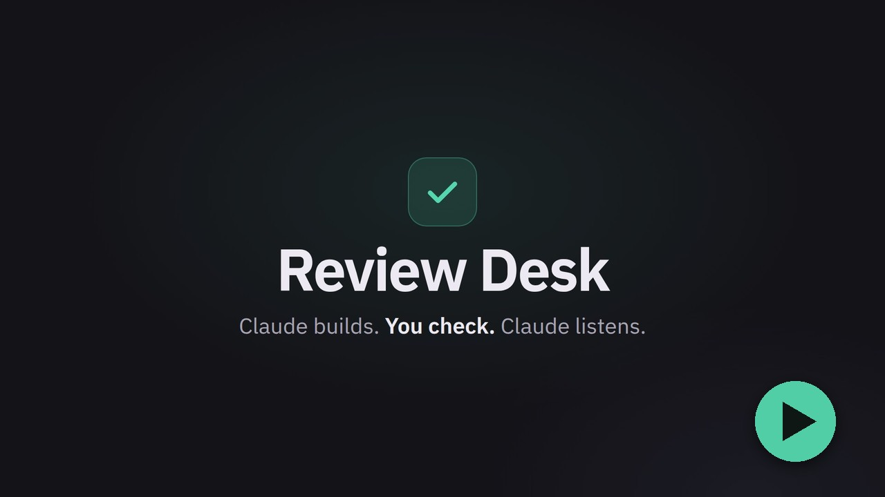

# Review Desk

**Claude builds. You check. Claude listens.**

A skill for [Claude Code](https://claude.com/claude-code): a page in your browser where you check what
Claude built, item by item, and hand your answers back, which wakes Claude up to go on.

[](https://youtu.be/2NTXfoz-iYQ)

## Why

Manual testing through a chat window means long lists to scroll back through, replies that mix up
item numbers, and screenshots without a home. With Review Desk, Claude writes a checklist, it shows
up on your page by itself, you answer each item, and one click hands everything back. No scripts to
run, nothing to copy over.

## The loop

1. **Claude writes a round:** a Markdown checklist in the project's `.review/` folder. It appears on
   your page within a second, in a sidebar with all your reviews and their progress.
2. **You answer:** a verdict per item (works, partly, needs a change: cosmetic, annoying or broken,
   can't test, skipped), a note, questions and ideas. Everything saves as you type.
3. **You hand it back:** the button wakes a background `review-desk wait` in Claude's session, which
   prints your answers. The page shows whether Claude is listening and when it has read them.
4. **Claude answers:** replies in the item's thread, fixes things and sends items back for another
   look (your earlier answers stay in their history), and marks your ideas as planned, done or not now.
   You hear about it with a soft chime or a desktop notification.

## What's on the desk

| | |
|---|---|
| **Attachments** | Screenshots you mark up (arrow, box, blur), screen recordings, lines from a log or a command's output, any file. Paste or drop them on an item. |
| **Run buttons** | The commands a checklist names run on this computer when you click, with live output and Stop. |
| **Viewer** | Linked files open on their line; the commit opens with its diff; pictures enlarge. |
| **Ideas board** | Every idea from every round, with Claude's answer. |
| **Question cards** | Claude's planning questions as cards while the page is open. |
| **Tally** | Click "3 left" to jump to the items you haven't answered yet, one after another. |
| **Summary** | A short Markdown summary of a round, to copy. |
| **Phone** | A QR code opens the desk on your phone over your home network, with its own secret, closed after eight hours. Answer and take photos there; commands never run from the phone. |
| **Look** | English and German, light and dark, the project's own accent colour. |

## Install

```bash
python3 tools/install.py
```

This links this folder as the skill (`~/.claude/skills/review-desk`) and puts a `review-desk` command
in `~/.local/bin`. Nothing is copied, so a `git pull` here updates both. Then check it:

```bash
review-desk selftest
```

Optional: `python3 tools/install.py --hook` adds a small session-start hook to
`~/.claude/settings.json`, so a new Claude session hears about answers that are waiting (it prints
nothing otherwise). `--remove` takes everything out again; your settings are backed up first.

**Needs:** Python 3.10 or newer, no packages. Linux tested; `notify-send` for desktop notifications
(the page chimes without it).

## Use

Ask Claude for a manual check, or type `/review-desk`. Claude starts the desk, writes the round and
listens; you answer on the page and click **Hand back to Claude**.

- `SKILL.md` is what Claude reads.
- `references/checklist.md`: the checklist format.
- `references/commands.md`: every command.
- `references/questions.md`: question cards.

## Privacy and safety

- The desk listens on `127.0.0.1` only, checks every request's host name and secret, and loads
  nothing from the internet.
- Reviews live in the project's `.review/` folder, kept out of git through `.git/info/exclude`.
- Run only runs what a checklist says, and only after your click.
- The phone's way in exists only while you turn it on; the firewall is checked, never changed.
- Approvals (merging, pushing, publishing) stay in the chat; a hand-back is never one.

## Develop

```bash
python3 -m unittest discover -s tests
```

The page is plain HTML, CSS and JavaScript in `assets/page/` (no build step); the desk is Python in
`scripts/desk/`. IBM Plex fonts are included under the SIL Open Font License
(`assets/fonts/OFL.txt`).
